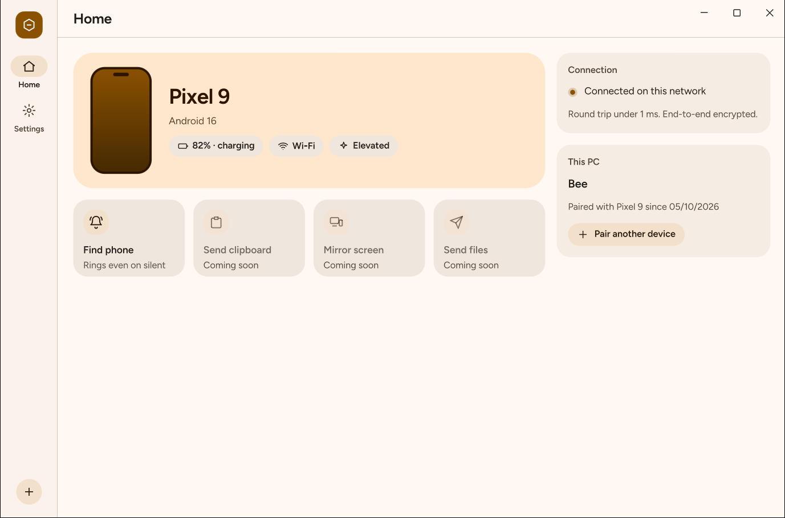
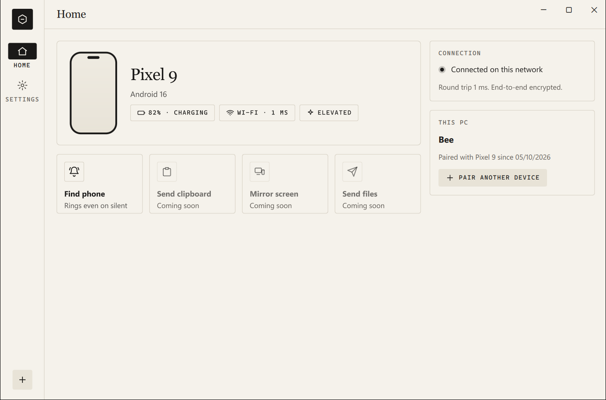
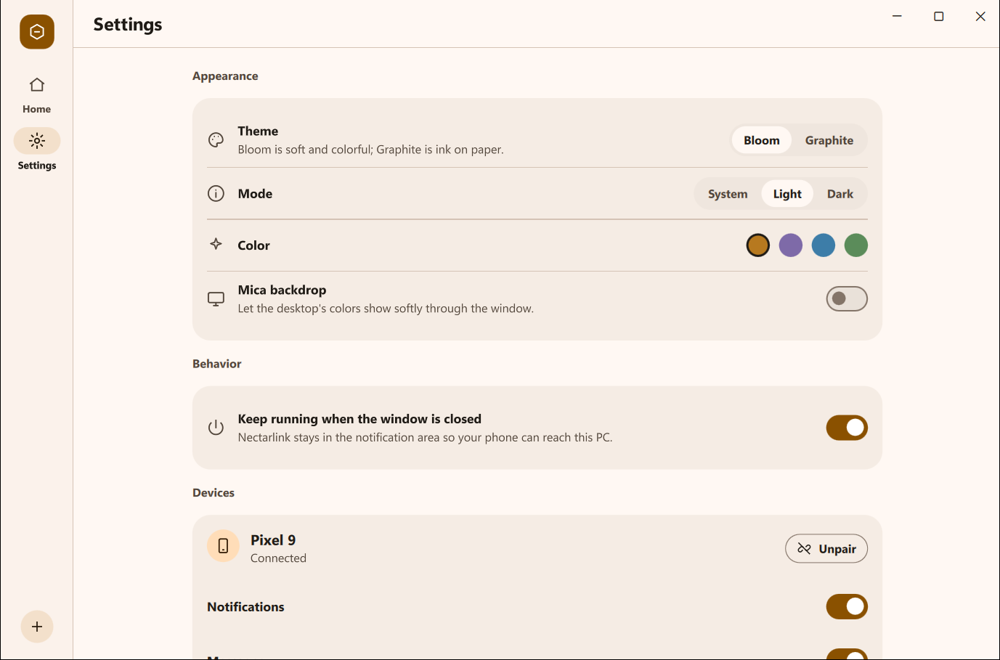
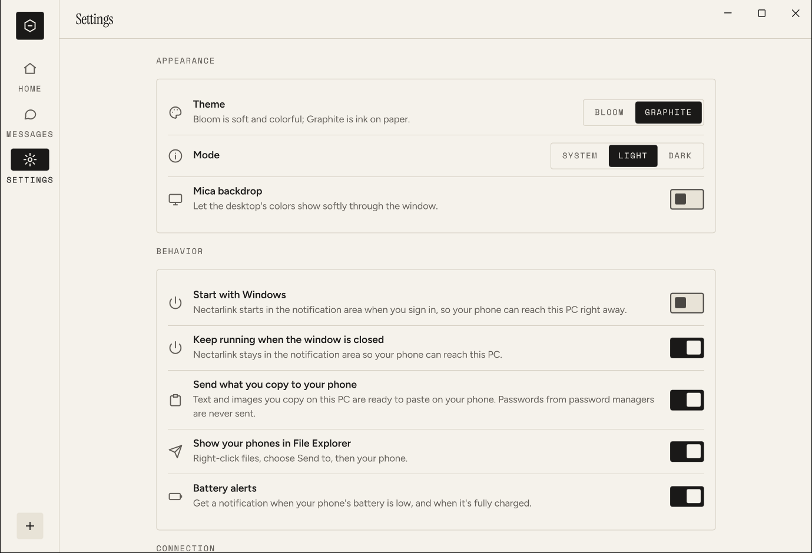
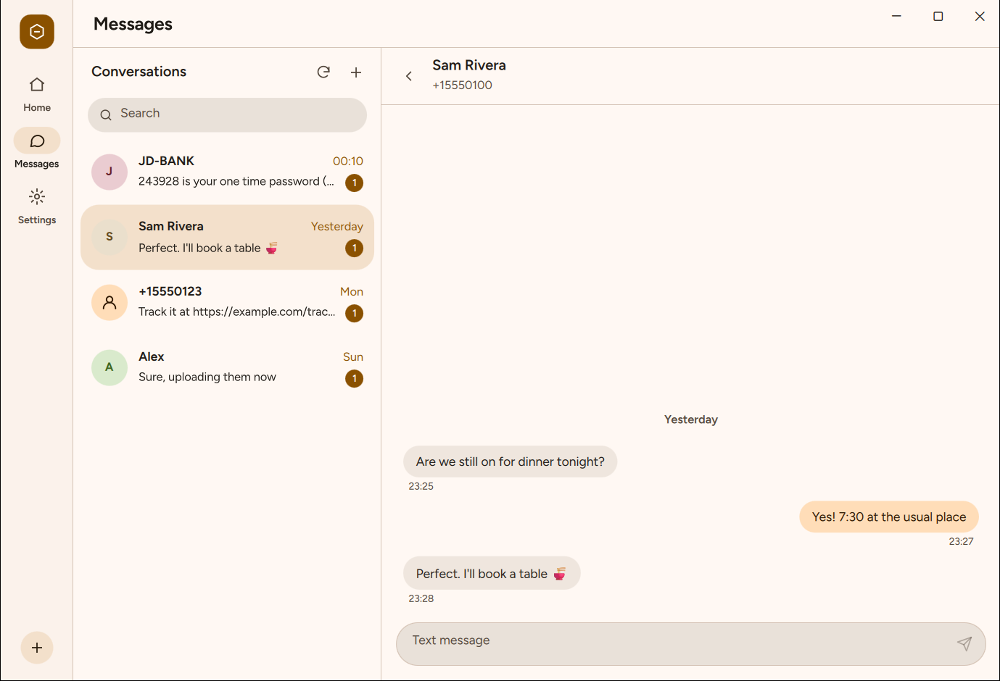
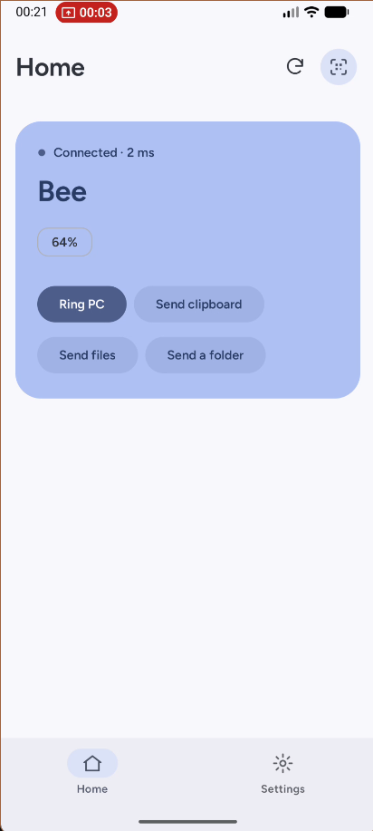

<div align="center">


# NectarLink

**Your Android phone and your PC, working as one.**

Notifications, messages, calls, clipboard, files, photos, screen mirroring and
phone apps in windows, between Android and Windows 10 (2004+) or 11. Free and open source.
Local-first, end-to-end encrypted, no account and no cloud.

Hi, I'm Bee, and yes, a bee built an app called NectarLink. I build cool stuff
in the open on [𝕏 @thtbee_](https://x.com/thtbee_), so come see what's next.
Feedback, bugs or ideas? DM me directly.

[](https://github.com/thtbee/nectarlink/releases/latest)
[](https://github.com/thtbee/nectarlink/actions/workflows/ci.yml)
[](LICENSE)
[](LICENSE)

</div>

<p align="center">
  
</p>

## Why NectarLink

NectarLink came out of my own frustration. I kept juggling Phone Link for
notifications and messages, KDE Connect for the clipboard and LocalSend for
files, and always wanted one app that did all of it. So I made one.

It covers what those three did for me, with one app on each side, plus a lot
of new features I wanted that I think you'll enjoy having too.

## Download

| | Download | Needs |
|---|---|---|
| **Windows (x64)** | [Installer (.exe)](https://github.com/thtbee/nectarlink/releases/download/v0.1.4/Nectarlink-0.1.4-x64-setup.exe) | Windows 10 (2004+) or 11, 64-bit Intel or AMD (Phone as webcam needs Windows 11) |
| **Windows (ARM64)** | From the next release | Windows 11 on ARM (Snapdragon) |
| **Linux (x86_64)** | From the next release: [one command](#on-linux), or a .deb, .rpm, AppImage or .tar.gz | Ubuntu 24.04 or newer, Debian 13, Fedora 40 or newer, 64-bit Intel or AMD |
| **Android** | [App (.apk)](https://github.com/thtbee/nectarlink/releases/download/v0.1.4/Nectarlink-0.1.4-android.apk) | Android 8.0 or newer |

The apps update themselves from GitHub Releases and check every download
against its SHA-256 sums.

### On Linux

From the next release, one command installs NectarLink with everything it
needs, and shows each step as it goes:

```bash
curl -fsSL https://github.com/thtbee/nectarlink/releases/latest/download/install.sh | sh
```

It picks the package for your system (.deb with apt, .rpm with dnf or zypper,
the tarball elsewhere), checks it against the release's SHA-256 sums and
installs it with its dependencies. Then it sets up the phone as a webcam, the
phone as a keyboard and mouse, and the firewall for your local network only.
To remove it all again, end the same command with `sh -s -- --uninstall`
instead of `sh`. See [Installing on Linux](docs/guide/getting-started.md#on-linux)
for the details.

> [!NOTE]
> SmartScreen may warn about the Windows installer the first time, because it
> isn't code-signed yet: choose **More info**, then **Run anyway**. On Android,
> allow your browser or file manager to install apps when asked.

> [!IMPORTANT]
> In India and many other countries, Google Play Protect blocks the APK with
> no **Install anyway** button. Pause **Scan apps with Play Protect** while you
> install it (Play Store › your profile › Play Protect › Settings), then turn it
> back on, or install it from a PC with `adb install`. See
> [Play Protect blocks the APK](docs/guide/troubleshooting.md#google-play-protect-blocks-the-apk-without-an-install-anyway-button).

## Get started

1. Install NectarLink on your PC and on your phone.
2. On the PC, the setup walkthrough shows a QR code. Scan it with the phone
   (from the NectarLink app or any camera app), or pick the PC from the phone's
   list of nearby devices and compare a 6-digit code. A USB cable works too.
3. Allow what you want to share. Every feature has its own switch per device,
   and the sensitive ones are off until you turn them on.
4. Optional: set up **Wireless debugging** once in the phone app for the
   features Android reserves for privileged apps (phone apps in windows, real
   touch input, background clipboard sync). No root, nothing else to install.

The [user guide](docs/guide/README.md) walks through every step and feature.

## What it does

**Stay on top of your phone**
- **Notifications** on the PC, with replies, actions, Live Updates (progress,
  timers, deliveries) and a **Copy code** button for one-time codes. Clear on
  one side, cleared on the other.
- **Messages**: SMS and MMS conversations plus chats from RCS, WhatsApp,
  Telegram, Signal and other apps in one inbox. Reply, send pictures, start
  new conversations.
- **Calls**: see who's calling, answer, decline or hang up from the PC, call
  any number or contact through the phone, and browse recent calls.

**Move things between devices**
- **Clipboard**: copy on one device, paste on the other, with optional
  encrypted history. Passwords from password managers are never sent, and
  one-time codes are never kept in the history.
- **Files and folders** both ways at Wi-Fi speed, with resume after a dropped
  connection, **Send to** in File Explorer, and the phone's storage in File
  Explorer.
- **Photos**: the phone's camera roll, screenshots and albums on the PC.
- **Handoff**: links, maps and videos (at the same timestamp) open on the
  other device.

**Use your phone from the PC**
- **Screen mirroring** at up to 60 frames a second with the phone's sound,
  screenshots and recording.
- **Apps**: open any phone app in a window of its own on the PC, with its own
  taskbar icon, running beside whatever the phone shows.
- **Type on the phone** with the PC keyboard, without mirroring.
- **Phone controls** on the PC: Do Not Disturb, ringer, volume, flashlight,
  brightness, Wi-Fi and Bluetooth.

**Use your PC from the phone**
- **Touchpad, air mouse, keyboard, voice typing and presentation remote.**
- **Deck**: a Stream Deck style grid of buttons for the PC (media, shortcuts,
  apps, OBS Studio, commands), with live volume and mute.
- **Lock, sleep and wake** the PC.

**Camera and sound**
- **Phone as a webcam** in Zoom, Teams, Meet, OBS and the Camera app.
- **Continuity Camera**: take a photo or scan a document with the phone and
  have it on the PC's clipboard.
- **Phone as a speaker** for the PC's sound, and a **voice recorder** that
  saves straight to the PC.

**And more**: media controls both ways, battery alerts, Find my device, a
searchable **Timeline** of everything that moved, a **Command Palette**
(`Ctrl+Alt+Space`), a slide-out **Shelf**, a home-screen widget, and a
**Connection Doctor** that finds and fixes what keeps devices from connecting.
Four themes, **Hive**, **Bloom**, **Glass** and **Graphite**, each in light
and dark.

### Platform support

| Feature | Windows | Linux | macOS (Preview) |
|---|---|---|---|
| Pairing & mutual TLS | Yes | Yes | Yes |
| Files & folder transfer | Yes | Yes | Yes |
| Photos browser & download | Yes | Yes | Yes |
| Continuity Camera | Yes | Yes | Yes |
| Calls & SMS viewer | Yes | Yes | Yes |
| Phone quick toggles & volume | Yes | Yes | Yes |
| Clipboard text & image sync | Yes | Yes | Yes (two-way text, incoming photo) |
| System notifications | Yes | Yes | Yes (system banners) |
| Phone screen mirroring | Yes | Yes | Not yet (in development) |
| Screen recording (MP4) | Yes | Yes | Not yet |
| PC audio stream / phone mic | Yes | Yes | Not yet |
| Phone as webcam | Yes | Yes (with v4l2loopback) | Not yet |
| Phone storage in the file manager | Yes | Yes | Not yet |

## Private by design

- **Local-first.** Devices talk directly over your network or a USB cable.
  Nothing goes through a server, and there's no account.
- **End-to-end encrypted.** Every connection is QUIC with TLS 1.3, authenticated
  with device keys exchanged when you pair. Keys are protected by Windows DPAPI
  and the Android Keystore.
- **You decide what's shared.** Each paired device has its own feature
  switches. Remote control of the PC, shell commands and phone storage are off
  until you allow them.
- **The only internet traffic** is the update check against GitHub Releases
  (which you can turn off), and, if you turn it on, **Connect over mobile
  data**, which relays encrypted traffic it can't read.

Details: [Privacy and security](docs/guide/privacy-and-security.md) and the
[security model](docs/technical/security-model.md).

## Screenshots

**Hive** is an exclusive theme: honey, with a living honeycomb that breathes
behind the app.

| Hive, light | Hive, dark |
|:---:|:---:|
|  |  |

Also **Bloom**, soft and colorful; **Glass**, translucent cards over the
Windows backdrop; and **Graphite**, ink on paper. All in light and dark.

| Bloom | Glass | Graphite |
|:---:|:---:|:---:|
|  |  |  |
|  |  |  |

<p align="center">
  <br>
  <sub>The phone's apps on the PC, each in a window of its own.</sub>
</p>

<p align="center">
  <br>
  <sub>The phone's texts on the PC.</sub>
</p>

<p align="center">
  <br>
  <sub>The whole phone screen in a window, with mouse and keyboard control.</sub>
</p>

<p align="center">
  <br>
  <sub>Pairing by QR code, and the Android app once connected.</sub>
</p>

## How it works

```
 Android app (Kotlin, Compose)            Windows app (Qt Quick, Rust)
          │ UniFFI                                │ cxx-qt
          ▼                                       ▼
 ┌─────────────────────┐   QUIC (iroh),   ┌─────────────────────┐
 │  nectarlink-core    │◄────────────────►│  nectarlink-core    │
 │  pairing, sessions, │  end-to-end      │  pairing, sessions, │
 │  storage, features  │  encrypted       │  storage, features  │
 └─────────────────────┘                  └─────────────────────┘
```

- **One core, two apps.** Protocol, pairing, sessions, the trust store and the
  capability matrix live in Rust (`core/`) and run unchanged on both platforms.
- **Native on both sides.** A Windows 11 app built with Qt Quick and Rust, and
  an Android app built with Jetpack Compose.
- **Capability matrix.** Both apps work out which features a pair of devices
  supports and what would enable the rest, so the interface never offers
  something that can't work.
- **Protocol.** Versioned and documented in [docs/protocol/v0.md](docs/protocol/v0.md):
  length-prefixed CBOR messages on QUIC streams.

## Repository layout

```
core/
  nectarlink-protocol/   Message types, framing, pairing cryptography      (MPL-2.0)
  nectarlink-core/       Identity, trust store, pairing, sessions, features (MPL-2.0)
  nectarlink-ffi/        UniFFI bindings used by the Android app          (MPL-2.0)
  nectarlink-adb/        Wireless debugging client for the phone's helper  (MPL-2.0)
  nectarlink-cli/        Command-line client (`nectarlink`)                (GPL)
desktop/
  app/                   Windows app: Rust host, cxx-qt bridge, QML UI     (GPL)
  vcam/                  Windows 11 virtual camera Media Foundation DLL    (GPL)
  installer/             NSIS installer script and Sparse Package manifest (GPL)
android/                 Android app: Kotlin and Jetpack Compose (API 26+) (GPL)
assets/fonts/            Fonts both apps ship with                         (OFL-1.1)
assets/brand/            The app icon (see the trademark policy)
tools/xtask/             Code generation (theme tokens) and checks         (GPL)
spikes/                  Technical experiments with their results
scripts/                 Build, packaging and check scripts
docs/                    Guide, technical docs, protocol, design system    (CC BY 4.0)
```

## Building from source

| Part | Needs |
|---|---|
| Core and CLI | [Rust](https://rustup.rs) (stable, pinned in `rust-toolchain.toml`) |
| Windows app | Windows 11, Visual Studio 2022 Build Tools (C++), [Qt 6.12](https://www.qt.io/download-open-source) for MSVC 2022 x64 |
| Linux app | Ubuntu 24.04 or newer (glibc 2.39), a C++17 compiler, pkg-config, the X11, Wayland and D-Bus development packages, [Qt 6.12](https://www.qt.io/download-open-source) (`gcc_64`, with Qt Shader Tools and Qt Wayland Compositor) |
| macOS app | macOS 14+, Xcode Command Line Tools, [Qt 6.12](https://www.qt.io/download-open-source) (or Homebrew Qt 6) |
| Android app | Android SDK (platform 37, NDK 30.0.16248370), JDK 17 or newer, `cargo-ndk` (see [android/README.md](android/README.md)) |

```sh
cargo test -p nectarlink-protocol -p nectarlink-core -p nectarlink-ffi   # core and tests
cargo run -p nectarlink-cli -- --help                                     # command-line client
cargo run -p nectarlink-desktop                                           # Windows app (Qt's bin on PATH)
cd android && ./gradlew assembleDebug                                     # Android app
```

```powershell
./scripts/package.ps1    # Windows installer: target\package\Nectarlink-<version>-x64-setup.exe
./scripts/check.ps1      # every check CI runs; add -Android and -Arm64 for the full set
```

Releases are built by CI from a `v*` tag; see
[docs/technical/releasing.md](docs/technical/releasing.md).

## Documentation

- [User guide](docs/guide/README.md): setup, pairing and every feature, on Windows and Android
- [Technical documentation](docs/technical/README.md): architecture, security model, protocol, storage, performance and builds
- [Protocol v0](docs/protocol/v0.md) and the [capability registry](docs/protocol/capabilities.md)
- [Architecture decision records](docs/adr) and the [design system](docs/design/README.md)
- [Project plan and roadmap](docs/PLAN.md)

## Questions and ideas

Ask questions, share ideas and show your setup in
[Discussions](https://github.com/thtbee/nectarlink/discussions). Issues are for
bugs and agreed feature work.

## Contributing

Contributions are welcome. Please read [CONTRIBUTING.md](CONTRIBUTING.md) first;
for anything larger than a small fix, open an issue to agree on the approach.
Contributions are accepted under the [Developer Certificate of Origin](DCO.txt),
and everyone is expected to follow the [Code of Conduct](CODE_OF_CONDUCT.md).

To translate NectarLink into your language, see
[docs/translating.md](docs/translating.md).

To report a security issue, follow [SECURITY.md](SECURITY.md). Please don't
open a public issue.

## License

- Windows and Android apps, CLI: [GPL-3.0-or-later](LICENSES/GPL-3.0-or-later.txt),
  with an [app-store exception](LICENSES/APP-STORE-EXCEPTION.md)
- Core libraries: [MPL-2.0](LICENSES/MPL-2.0.txt)
- Protocol specification and documentation: [CC BY 4.0](LICENSES/CC-BY-4.0.txt)

See [LICENSE](LICENSE) for which license applies where. The NectarLink name and
logo are covered by the [trademark policy](TRADEMARKS.md).
