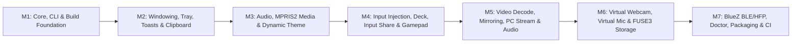

# Linux as a Connected System — Architecture & Implementation Plan

This document details the complete analysis and milestone roadmap for bringing **Linux** to full feature parity as a first-class connected desktop peer in **NectarLink**, alongside Windows and Android, including the **Virtual Microphone ("Phone as Microphone", [GH Issue #7](https://github.com/thtbee/nectarlink/issues/7))** feature.

> [!IMPORTANT]
> **Strict Architectural Preservation**: NectarLink's existing architecture—a single-process Rust + Qt 6 Quick/QML (`cxx-qt`) desktop binary (`nectarlink-desktop`) hosting `nectarlink-core` (`core_host.rs`), exposing reactive `bridge::*` QObjects to QML, rendering custom C++ scene-graph nodes (`NativeWindow`, `VideoView`), and delegating OS integration through a unified platform module boundary (`crate::win::*`)—is preserved **100% intact**. No new daemons, IPC layers, or UI frameworks are introduced.

---

## 1. Architectural Alignment Overview

```mermaid
flowchart TD
    subgraph QML["Qt 6 Quick / QML UI (Unchanged)"]
        MW["MainWindow.qml / MirrorWindow.qml / MiniPlayerWindow.qml"]
        CPP["C++ Scene Graph: NativeWindow & VideoView"]
    end

    subgraph Bridge["cxx-qt Bridge QObjects (Unchanged)"]
        BO["AppState / DeviceList / TransferList / NotificationList / MediaControl / PhotoGallery / Mirror / Prefs"]
    end

    subgraph Services["Desktop Feature Services (desktop/app/src/*.rs)"]
        CH["core_host.rs"]
        MIR["mirror.rs / pc_mirror.rs / webcam.rs / vmic.rs"]
        AUD["pc_audio_stream.rs / recordings.rs / deck.rs"]
        STO["storage.rs / local_api.rs / doctor.rs"]
    end

    subgraph Platform["OS Abstraction Layer (crate::win::*)"]
        WIN["#[cfg(windows)] desktop/app/src/win/* (29 modules)"]
        LIN["#[cfg(target_os = \"linux\")] desktop/app/src/linux/* (29 modules)"]
    end

    subgraph Core["Shared Workspace Crates (core/*)"]
        NC["nectarlink-core (QUIC/iroh, mDNS, SQLite, LocalSend, Handoff)"]
        NP["nectarlink-protocol (CBOR Wire Framing)"]
        NA["nectarlink-adb (ADB TCP & USB Tunnel)"]
        NCLI["nectarlink-cli (CLI & notify-when)"]
    end

    MW --> CPP
    MW --> BO
    BO --> Services
    Services --> Platform
    CH --> NC
    NC --> NP
    CH --> NA
    NCLI --> NC
```

### How Linux Slots Into the Existing Design
1. **Mount-Point Parity (`crate::win`)**:
   In [`desktop/app/src/main.rs`](../desktop/app/src/main.rs#L35), the platform module is mounted as:
   ```rust
   #[cfg(windows)]
   mod win;
   #[cfg(target_os = "linux")]
   #[path = "linux/mod.rs"]
   mod win;
   ```
   By exposing the **exact same public function signatures, structs, and enums** from `desktop/app/src/linux/` as `desktop/app/src/win/`, all 4,900+ lines of `cxx-qt` bridge logic in [`main.rs`](../desktop/app/src/main.rs), [`core_host.rs`](../desktop/app/src/core_host.rs), and QML views require zero structural divergence.
2. **Wayland-First with X11 Fallbacks**:
   Modern Linux desktops predominantly run Wayland (GNOME, KDE Plasma 6, Sway, Hyprland) while X11 remains widespread. Every display/input/capture subsystem uses desktop-environment-neutral **XDG Desktop Portals + PipeWire + D-Bus** first, with automatic fallback to **X11 / uinput / ALSA** when running on X11 or minimal window managers.

---

## 2. Core, Protocol & CLI Changes (`core/*` & `android/`)

The `core/` workspace crates are already ~98% cross-platform (`nectarlink-protocol` and `nectarlink-adb` are 100% OS-agnostic). Five targeted updates are required across `core/` (plus the Android microphone streamer for Virtual Microphone):

### 2.1 Feature Catalog & Desktop Role Recognition
* **File**: [`core/nectarlink-core/src/features.rs`](../core/nectarlink-core/src/features.rs#L304-L313)
* **Issue**: `role_from(kind: DeviceKind, os: &str)` currently matches only `"windows" | "macos" => Some(Role::Desktop)`. An Android peer or another PC connecting to a Linux desktop would classify its `Hello` (`kind: Desktop, os: "linux"`) as `None` (unsupported role), disabling feature availability checks in the feature matrix.
* **Change**:
  ```rust
  (DeviceKind::Desktop, "windows" | "macos" | "linux") => Some(Role::Desktop),
  ```
* **Note on `WindowsBuildAtLeast`**: In [`features.rs`](../core/nectarlink-core/src/features.rs#L483-L491), `Requirement::WindowsBuildAtLeast(min)` already returns `Check::Met` when `facts.os != "windows"`, so `camera.webcam` and other desktop capabilities automatically pass on Linux.

### 2.2 Device Identity Key Protection (XDG Secret Service / Keyring)
* **File**: [`core/nectarlink-core/src/identity.rs`](../core/nectarlink-core/src/identity.rs#L172-L180)
* **Current State**: Uses `DpapiKeyProtector` (`id = 1`) on `#[cfg(windows)]` and `PlainKeyProtector` (`id = 0`) on `#[cfg(not(windows))]`.
* **Change**: Add `SecretServiceKeyProtector` (`id = 2`) under `#[cfg(target_os = "linux")]`:
  * Stores/retrieves a 256-bit wrapping key in the user's login keyring via the standard `org.freedesktop.secrets` D-Bus API (GNOME Keyring / KWallet / KeePassXC) or kernel `keyctl` session keyring, encrypting the Ed25519 identity secret with ChaCha20-Poly1305.
  * Gracefully falls back to `PlainKeyProtector` (`id = 0`, `0600` file permissions) on headless/CI systems without a D-Bus session bus, while keeping `unprotect_with_known` backward-compatible with existing `0x00` keys.

### 2.3 Deck App-Launch Path Validation
* **File**: [`core/nectarlink-core/src/deck.rs`](../core/nectarlink-core/src/deck.rs#L229-L234)
* **Issue**: `is_valid_app_path(path: &str)` requires paths to end with `.exe` or `.lnk`.
* **Change**: Extend validation to accept `.desktop` application IDs/files, `.appimage` / `.sh`, or absolute Unix executable paths (`path.starts_with('/')` without `..` traversal) so Linux Deck `LaunchApp` tiles pass validation.

### 2.4 CLI Desktop IPC & `notify-when` Process Watcher
* **File**: [`core/nectarlink-cli/src/main.rs`](../core/nectarlink-cli/src/main.rs#L5218-L5597)
* **Current State**: `TaskTransport::DesktopDir` (delegating CLI `--notify`, `--ring`, `--lock`, `--clipboard` commands to the running desktop GUI instance) and `notify-when <pid>` (`mod win_watch`) are gated on `#[cfg(windows)]`.
* **Changes**:
  1. Enable `TaskTransport::DesktopDir` on `#[cfg(any(windows, target_os = "linux"))]`: check if the desktop app holds an active `flock` on `<data_dir>/instance.lock` (or responds on `<data_dir>/instance.sock`), write `<data_dir>/requests/<id>.json`, and notify `<data_dir>/instance.sock`.
  2. Add `#[cfg(target_os = "linux")] mod linux_watch` implementing the same `WatchedProcess`, `open_process(pid)`, and `wait_process(proc)` interface as `win_watch`:
     * Read process name from `/proc/<pid>/comm` and start time (`starttime` tick field 22 in `/proc/<pid>/stat` converted via `/proc/stat` `btime` + `sysconf(_SC_CLK_TCK)`).
     * Wait for process exit with zero polling overhead using `pidfd_open(pid, 0)` + `poll()` (Linux 5.3+), with fallback to `/proc/<pid>` existence check.

### 2.5 Virtual Microphone Protocol & Android Capture ([GH Issue #7](https://github.com/thtbee/nectarlink/issues/7))
* **Background**: In [`docs/PLAN.md`](PLAN.md#L191) (§3.8), using the Android phone's microphone as a live input device for PC apps (dictation, Discord, Zoom, OBS) — the reverse of "Phone speaker" ([`pc_audio_stream.rs`](../desktop/app/src/pc_audio_stream.rs)) — was deferred on Windows only because Windows lacks a built-in user-space virtual microphone API. On **Linux**, PipeWire and PulseAudio natively support creating user-space `Audio/Source` virtual microphones without any kernel driver or root privileges, while both Linux and Windows can also route the stream to a selectable audio output / virtual audio cable (e.g. VB-Cable).
* **Protocol Additions** ([`core/nectarlink-protocol/src/messages.rs`](../core/nectarlink-protocol/src/messages.rs)):
  * Modeled symmetrically on the Virtual Webcam protocol ([`docs/protocol/webcam.md`](protocol/webcam.md), [`messages.rs`](../core/nectarlink-protocol/src/messages.rs#L93-L96)) and `AudioPcmFrame` ([`messages.rs`](../core/nectarlink-protocol/src/messages.rs#L5416)):
    * Message types: `MIC_START = "mic.start"`, `MIC_STOP = "mic.stop"`, `MIC_OK = "mic.ok"`.
    * Capabilities (`pub mod mic`): `mic::STREAM = "mic.stream"` (phone capability) and `mic::VIRTUAL = "mic.virtual"` (desktop capability).
    * Payloads:
      ```rust
      pub struct MicStart {
          pub sample_rate: u32,     // default 48_000
          pub channels: u8,         // 1 (mono) or 2 (stereo), default 1
          pub noise_suppress: bool, // Android hardware NoiseSuppressor
          pub echo_cancel: bool,    // Android hardware AcousticEchoCanceler
      }
      pub struct MicConfig {
          pub codec: String,        // "pcm_s16le"
          pub rate: u32,            // 48_000
          pub channels: u8,         // 1 or 2
      }
      ```
* **Feature Catalog Entry** ([`core/nectarlink-core/src/features.rs`](../core/nectarlink-core/src/features.rs#L868)):
  * Add `"audio.mic"` ("Phone as Microphone") requiring `phone(mic::STREAM, Unlock::Permission(Permission::Microphone))`, `desktop(mic::VIRTUAL, UPDATE)`, and `Requirement::DeviceToggle("microphone")` (explicit user opt-in on the phone, matching `camera.webcam`).
* **Android Microphone Streamer (`android/app/`)**:
  * Captures low-latency 48 kHz 16-bit PCM via `AudioRecord` (`MediaRecorder.AudioSource.MIC`, or `VOICE_COMMUNICATION` when `noise_suppress` / `echo_cancel` is enabled) in 5 ms frames (480 bytes mono / 960 bytes stereo) and sends `AUDIO_PCM` (`AudioPcmFrame`) over the active session.
  * Enforces the same privacy guarantees as [`docs/protocol/webcam.md`](protocol/webcam.md): requires the phone-side `"microphone"` toggle to be enabled and runs in a `foregroundServiceType="microphone"` service displaying an ongoing notification (*"Streaming microphone to \<PC name\>"* with a **Stop** button).

---

## 3. Build System & C++ Scene Graph (`desktop/app/build.rs` & `cpp/`)

### 3.1 Build Script (`desktop/app/build.rs`)
* **File**: [`desktop/app/build.rs`](../desktop/app/build.rs#L280-L286)
* **Issue**: Lines 282–285 unconditionally emit `cargo:rustc-link-lib=dwmapi`, `ole32`, `shell32`, `user32`.
* **Change**: Gate those four lines behind `if std::env::var("CARGO_CFG_TARGET_OS").as_deref() == Ok("windows")`.
* **Cargo Dependencies** ([`desktop/app/Cargo.toml`](../desktop/app/Cargo.toml)):
  * Move `windows = { ... }` under `[target.'cfg(windows)'.dependencies]`.
  * Add `[target.'cfg(target_os = "linux")'.dependencies]` for Linux integration crates (`libc`, `zbus` or `dbus` for D-Bus portals/MPRIS/BlueZ/Notifications, `fuser` for FUSE3 storage mount, `ashpd` or portal D-Bus bindings, `pipewire` / `libpulse-binding` for audio/screen-cast/virtual-mic, `evdev` / `uinput` for input/gamepad).

### 3.2 C++ Native Window & Video View (`desktop/app/cpp/`)
* **[`app_helpers.cpp`](../desktop/app/cpp/app_helpers.cpp)** and **[`video_view.cpp`](../desktop/app/cpp/video_view.cpp)**:
  * Already guard Windows-specific code with `#ifdef _WIN32`!
  * `VideoView` already includes a complete software-fallback `QSGSimpleTextureNode` path (`uploadSoftwareFrame`) when D3D11 zero-copy is not active, and can be optionally enhanced on Linux with `DMABUF` / OpenGL / Vulkan texture import where available.
* **[`native_window.cpp`](../desktop/app/cpp/native_window.cpp)**:
  * Currently includes `<windows.h>`, `<d3d11.h>`, `<dwmapi.h>`, `<dxgi1_3.h>` unconditionally.
  * **Change**: Guard the Win32 `WM_NCHITTEST` / DWM backdrop code with `#ifdef _WIN32` and add a `#else` Linux implementation:
    * Apply `Qt::FramelessWindowHint` and translucent surface (`QQuickWindow::setColor(Qt::transparent)`).
    * Install a `QObject::eventFilter` on the `QQuickWindow` that handles `QEvent::MouseButtonPress`, `QEvent::MouseMove`, and `QEvent::MouseButtonDblClick`:
      * When cursor is within `resizeBorderWidth_` of window edges and window is not maximized, call `window_->startSystemResize(edges)` (supported natively by both Wayland `xdg_toplevel::resize` and X11 `_NET_WM_MOVERESIZE`) and update cursor shapes (`Qt::SizeHorCursor`, `Qt::SizeVerCursor`, `Qt::SizeFDiagCursor`, `Qt::SizeBDiagCursor`).
      * When pressing inside the custom QML titlebar (`y < titleBarHeight_`) outside interactive QML controls (`hitInteractiveControl` check), call `window_->startSystemMove()` on drag and toggle maximize on double-click.
    * Set KWin / KDE blur effect property (`_KDE_NET_WM_BLUR_BEHIND_REGION`) when available so translucent glass tinting matches Windows Acrylic/Mica aesthetics.

---

## 4. Desktop Feature Services & Direct Win32 Usages Outside `src/win/` (`desktop/app/src/*.rs`)

Before examining the 29 modules inside `src/win/`, the following files in `desktop/app/src/` have direct Windows assumptions or new cross-platform service logic (`vmic.rs`):

| File | Current State / Windows Dependency | Linux & Cross-Platform Implementation |
| :--- | :--- | :--- |
| [`core_host.rs`](../desktop/app/src/core_host.rs#L356) | Hardcodes `os: "windows".into()` in `PeerInfo` and `DeviceFacts::for_os("windows")` | Use `std::env::consts::OS` (`"linux"` on Linux, `"windows"` on Windows) and `crate::win::os_build_number()` |
| [`local_api.rs`](../desktop/app/src/local_api.rs#L106) | Calls `CryptographicBuffer::GenerateRandom(32)` before `crate::win::secure_random` | Call `crate::win::secure_random(&mut bytes)` directly (removes redundant WinRT call) |
| [`pc_mirror.rs`](../desktop/app/src/pc_mirror.rs#L1-L40) | Uses Win32 `GDI BitBlt` + Media Foundation H.264 encoder to stream PC screen to phone | Delegate screen frame capture + H.264 encode to platform backend: **XDG Desktop Portal `ScreenCast` + PipeWire** (with X11 `XShmGetImage` fallback) feeding `crate::win::h264::H264Encoder` (VA-API / GStreamer / OpenH264) |
| [`pc_audio_stream.rs`](../desktop/app/src/pc_audio_stream.rs#L24-L32) | Uses WASAPI loopback (`AUDCLNT_STREAMFLAGS_LOOPBACK`) to capture PC audio for phone | Capture default sink monitor stream via **PipeWire / PulseAudio** (`@DEFAULT_MONITOR@` float32 stereo 48 kHz) feeding the existing `BiquadStereo` 5-band EQ and `f32_stereo_to_i16le` framing |
| **`vmic.rs` (New — [GH Issue #7](https://github.com/thtbee/nectarlink/issues/7))** | Counterpart to [`webcam.rs`](../desktop/app/src/webcam.rs) and reverse of [`pc_audio_stream.rs`](../desktop/app/src/pc_audio_stream.rs) | Manages the "Phone as Microphone" session (`start_mic`, `stop_mic`, `on_mic_pcm`), applies software gain (`-12..+24 dB`), mute toggle, and RMS peak level metering, and feeds incoming 48 kHz PCM into `crate::win::vmic::VirtualMic` (native PipeWire/PulseAudio `Audio/Source` on Linux) and/or a selected output device (`PcmPlayer::new_for_device` for live monitoring or VB-Cable routing) |
| [`recordings.rs`](../desktop/app/src/recordings.rs#L250-L435) | `convert_audio` uses Media Foundation `IMFSourceReader`/`IMFSinkWriter` to transcode `.m4a` -> `.wav`/`.mp3`/`.flac` | Implement `convert_audio` on Linux via **GStreamer / FFmpeg** (`ffmpeg` / `libavcodec` pipeline) producing identical `.wav`, `.mp3`, or `.flac` outputs |
| [`storage.rs`](../desktop/app/src/storage.rs#L1-L120) | Uses Windows Cloud Files API (`cfapi.dll`) at `%USERPROFILE%\Nectarlink\<Phone>` | Implement on-demand **FUSE3 filesystem** (`fuser` crate) mounted at `~/Nectarlink/<Phone name>` (auto-unmounted on disconnect/drop via `fusermount3 -u`), mapping `lookup`/`readdir` -> `list_storage`, `read` -> `read_storage_range`, `write`/`create`/`setattr` -> `write_storage_file`, `rename` -> `rename_storage`, `unlink`/`rmdir` -> `delete_storage` |
| [`mirror.rs`](../desktop/app/src/mirror.rs#L1345-L1429) | `poll_xinput_gamepad` and `poll_winrt_gamepad` import `windows::Win32::UI::Input::XboxController` & `windows::Gaming::Input` | Gate with `#[cfg(windows)]` and add `#[cfg(target_os = "linux")]` `poll_linux_gamepad` reading `/dev/input/event*` via **Linux `evdev`** (`ABS_X/Y/RX/RY/Z/RZ`, `ABS_HAT0X/Y`, `BTN_SOUTH/EAST/NORTH/WEST/TL/TR/SELECT/START/MODE/THUMBL/THUMBR`) into the existing `GamepadState` struct |
| [`pc_notifications.rs`](../desktop/app/src/pc_notifications.rs#L1-L95) | Polls `UserNotificationListener` (WinRT) to forward PC notifications to Android | Subscribe to D-Bus `org.freedesktop.Notifications` monitor / `Notify` method calls (filtering out `app_name == "NectarLink"` to avoid feedback loops) and forward to opted-in phones |
| [`updater.rs`](../desktop/app/src/updater.rs) & [`setup.rs`](../desktop/app/src/setup.rs) | Expects `NectarLink-Setup-*.exe` / `.msi` and Windows scheduled tasks | Match Linux release assets (`NectarLink-*-x86_64.AppImage`, `.deb`, `.rpm`, `.tar.gz`); support atomic AppImage replacement when `$APPIMAGE` is set, or open package/release page when installed via system package manager |

---

## 5. Complete Mapping of All 29 Platform Modules (`desktop/app/src/linux/`)

Every submodule in `desktop/app/src/win/` (plus the new `vmic.rs` submodule) will have a direct counterpart in `desktop/app/src/linux/` exporting identical types and functions:

### 5.1 System & Lifecycle (`mod.rs`, `single_instance.rs`, `autostart.rs`, `shell.rs`, `elevated.rs`)
* **[`linux/mod.rs`](../desktop/app/src/win/mod.rs)**:
  * `with_com(f)` -> runs `f()` directly (no-op on Linux).
  * `machine_guid()` -> reads `/etc/machine-id` (fallback `/var/lib/dbus/machine-id`).
  * `os_version()` -> parses `PRETTY_NAME` from `/etc/os-release` + kernel version from `uname -r` (e.g. `"Ubuntu 24.04.2 LTS (Linux 6.8.0)"`).
  * `is_laptop()` -> checks `/sys/class/power_supply/BAT*` or `/sys/class/dmi/id/chassis_type` (`8`, `9`, `10`, `14`, `31`, `32`).
  * `power_saver()` -> queries `org.freedesktop.UPower.PowerProfiles` (`ActiveProfile == "power-saver"`) or `/sys/class/power_supply/BAT*/status == "Discharging"` with capacity <= 20%.
  * `system_dark()` -> queries XDG Settings Portal (`org.freedesktop.portal.Settings.Read("org.freedesktop.appearance", "color-scheme") == 1`), with fallback to `gsettings` / `~/.config/kdeglobals`.
  * `reduce_motion()` -> queries `org.freedesktop.portal.Settings` / `org.gnome.desktop.interface enable-animations` / KDE `AnimationDurationFactor`.
  * `work_area()` -> queries primary screen available geometry via Qt (`QGuiApplication::primaryScreen()->availableGeometry()`).
  * `secure_random(buf)` -> fills `buf` via `libc::getrandom` / `/dev/urandom`.
* **[`linux/single_instance.rs`](../desktop/app/src/win/single_instance.rs)**:
  * Acquires exclusive non-blocking `flock(LOCK_EX | LOCK_NB)` on `<data_dir>/instance.lock`.
  * Binds Unix domain listener at `<data_dir>/instance.sock` (`0600`). Secondary invocations (`--share`, `--task`, URI scheme) write a JSON payload to `<data_dir>/requests/<uuid>.json` and ping `instance.sock`, which fires the registered callback on the primary instance.
* **[`linux/autostart.rs`](../desktop/app/src/win/autostart.rs)**:
  * Manages `~/.config/autostart/nectarlink.desktop` (with `Exec=<exe> --minimized`, `X-GNOME-Autostart-enabled=true`) and XDG Background Portal (`org.freedesktop.portal.Background`) when running inside Flatpak.
* **[`linux/shell.rs`](../desktop/app/src/win/shell.rs)**:
  * `open_file` / `open_folder` / `open_url` -> `xdg-open` (and `org.freedesktop.FileManager1.ShowItems` for `select_in_explorer`).
  * `lock_workstation()` -> `loginctl lock-session` (fallback `xdg-screensaver lock` / `dbus-send` `org.freedesktop.ScreenSaver.Lock`).
  * `sleep_system()` -> `systemctl suspend` / `org.freedesktop.login1.Manager.Suspend`.
  * `launch_executable(path, args)` -> if `.desktop` ID, launches via `gtk-launch` / `gio launch`; otherwise spawns executable with detached stdio.
* **[`linux/elevated.rs`](../desktop/app/src/win/elevated.rs)**:
  * `run_elevated(prog, args)` -> executes via Polkit `pkexec`.
  * `is_elevated()` -> `unsafe { libc::geteuid() == 0 }`.

### 5.2 Desktop Shell Integration (`tray.rs`, `toast.rs`, `clipboard.rs`, `share_target.rs`, `shortcut.rs`, `jumplist.rs`, `widget.rs`)
* **[`linux/tray.rs`](../desktop/app/src/win/tray.rs)**:
  * Implements StatusNotifierItem (`org.kde.StatusNotifierItem` via D-Bus / `QSystemTrayIcon`) with dynamic menu items (device status, `Find My Phone`, `Send Clipboard`, `Send File…`, `Take Screenshot`, `Mirror Screen`, `Show`, `Exit`).
  * Global hotkeys (`Ctrl+Alt+S` share clipboard, `Ctrl+Alt+F` find phone): uses `org.freedesktop.portal.GlobalShortcuts` on Wayland and `XGrabKey` on X11.
  * Listens for `org.freedesktop.login1.Manager.PrepareForSleep(false)` to emit `TrayEvent::Resumed` (immediately triggering QUIC/mDNS reconnect after laptop wake) and `org.freedesktop.portal.Settings.SettingChanged` to emit `TrayEvent::AppearanceChanged`.
* **[`linux/toast.rs`](../desktop/app/src/win/toast.rs)**:
  * Uses `org.freedesktop.Notifications` D-Bus interface (`Notify`, `CloseNotification`, signals `ActionInvoked`, `NotificationClosed`).
  * Supports action buttons, inline reply (`inline-reply` action supported by KDE Plasma, Dunst, SwayNC), Transfer Progress bars (`value` hint `0..=100`), and maintaining a notification tag -> D-Bus `u32` ID map for live updates and dismissals.
* **[`linux/clipboard.rs`](../desktop/app/src/win/clipboard.rs)**:
  * Reads/writes text, HTML (`text/html`), PNG images (`image/png`), and file lists (`text/uri-list` `file://` URIs) via Qt `QGuiApplication::clipboard()` + Wayland `ext-data-control-v1` / `zwlr-data-control-v1` (or `wl-paste`/`wl-copy` / X11 `XFixes` selection watcher) so background clipboard sync works seamlessly across both X11 and Wayland.
  * Honors `x-kde-passwordManagerHint` (`"secret"`) MIME type to skip syncing password-manager entries.
* **[`linux/share_target.rs`](../desktop/app/src/win/share_target.rs)**, **[`linux/shortcut.rs`](../desktop/app/src/win/shortcut.rs)**, **[`linux/jumplist.rs`](../desktop/app/src/win/jumplist.rs)**:
  * Installs `~/.local/share/applications/nectarlink.desktop` (with `MimeType=x-scheme-handler/nectarlink;...` and Desktop Actions `[Desktop Action SendFile]`, `[Desktop Action Mirror]`, etc. for dock/taskbar right-click menus — equivalent to Windows Jump List).
  * Installs file-manager context-menu actions ("Send to Phone with NectarLink") for:
    * **KDE Dolphin**: `~/.local/share/kio/servicemenus/nectarlink-send.desktop`
    * **GNOME Files (Nautilus)**: `~/.local/share/nautilus/scripts/Send with NectarLink`
    * **XFCE Thunar / Nemo**: `~/.local/share/file-manager/actions/nectarlink-send.desktop`
* **[`linux/widget.rs`](../desktop/app/src/win/widget.rs)**:
  * Writes `<data_dir>/widget-state.json` atomically so Linux status bars (Waybar, Polybar, KDE Plasma widget, GNOME extension) and CLI tools can consume real-time battery/connection status.

### 5.3 Audio, Virtual Microphone & Media (`audio.rs`, `audio_out.rs`, `vmic.rs`, `sound.rs`, `media_sessions.rs`, `smtc.rs`)
* **[`linux/audio.rs`](../desktop/app/src/win/audio.rs)**:
  * Queries and controls default output sink and default input source volume (`0..=100`) and mute state, enumerates audio output devices (`list_output_devices`), switches the default output sink (`set_default_output_device`), and watches for sink/volume changes via **PipeWire / PulseAudio (`libpulse` / `pactl` / `wpctl`)**.
* **[`linux/audio_out.rs`](../desktop/app/src/win/audio_out.rs)**:
  * Implements `PcmPlayer` with the exact same adaptive lock-free `JitterBuffer` (60 ms target, 240 ms cap, cubic Hermite time-stretching for clock drift) outputting 48 kHz 16-bit stereo PCM via **PipeWire / PulseAudio simple/async stream** (fallback ALSA `snd_pcm_writei`).
  * Extends `PcmPlayer` (on both Linux and Windows) with `PcmPlayer::new_for_device(sample_rate, channels, device_id: Option<&str>)` so incoming audio streams can target a specific output sink (used by `vmic.rs` for live speaker monitoring or routing into a virtual audio cable like VB-Cable on Windows).
* **`linux/vmic.rs` & `win/vmic.rs` (Virtual Microphone — [GH Issue #7](https://github.com/thtbee/nectarlink/issues/7))**:
  * **On Linux (`linux/vmic.rs`) — Native Zero-Driver Virtual Microphone**:
    * Creates a first-class user-space virtual microphone input device (`media.class = "Audio/Source"`, `node.name = "nectarlink_vmic"`, `node.description = "NectarLink - <Phone name> Microphone"`) using **PipeWire native stream (`pw_stream` with `PW_DIRECTION_OUTPUT` + `media.class=Audio/Source`)** or **PulseAudio / PipeWire-Pulse (`module-pipe-source` backed by a FIFO in `$XDG_RUNTIME_DIR/nectarlink-vmic.pcm`)**.
    * Pulls 48 kHz 16-bit PCM frames from the adaptive lock-free `JitterBuffer` (with cubic Hermite clock-drift compensation and zero-fill on underrun) so any Linux desktop app — **dictation tools, Chrome/Firefox WebRTC, Discord, Zoom, OBS, Teams** — sees `"NectarLink - <Phone name> Microphone"` as a native selectable microphone source without root or kernel modules.
  * **On Windows & Linux (Output Endpoint / Virtual Cable Routing)**:
    * Additionally supports routing the phone mic stream to any user-selected `AudioOutputDevice` via `PcmPlayer::new_for_device` (e.g., `CABLE Input (VB-Audio Virtual Cable)` on Windows, or headphones for live monitoring).
* **[`linux/sound.rs`](../desktop/app/src/win/sound.rs)**:
  * Synthesizes the two-tone 880 Hz / 1320 Hz "Find My PC" alarm (`generate_alarm_wav`) and plays it at full volume over PipeWire/PulseAudio/ALSA until stopped or timed out.
* **[`linux/media_sessions.rs`](../desktop/app/src/win/media_sessions.rs)**:
  * Watches all `org.mpris.MediaPlayer2.*` bus names on the session D-Bus (excluding `org.mpris.MediaPlayer2.nectarlink`), reading `Metadata` (`xesam:title`, `xesam:artist`, `xesam:album`, `mpris:artUrl`, `mpris:length`), `PlaybackStatus`, and `Position`, and forwarding `Play`/`Pause`/`Next`/`Previous`/`Stop` from the Android phone to the active Linux media player (Spotify, Firefox, VLC, MPV, Rhythmbox, Elisa, etc.).
  * Fetches `mpris:artUrl` (`file://` or `http(s)://`) and scales cover art via `crate::win::image`.
* **[`linux/smtc.rs`](../desktop/app/src/win/smtc.rs)**:
  * Exports `org.mpris.MediaPlayer2` and `org.mpris.MediaPlayer2.Player` on the session D-Bus as `org.mpris.MediaPlayer2.nectarlink`!
  * Publishes the Android phone's currently playing track, artist, album art (written to a temp file URI), and playback status to the Linux desktop's system media applet (GNOME Quick Settings, KDE Media Player plasmoid, Swaync, hardware media keys) and routes desktop play/pause/next/prev clicks back to the phone.

### 5.4 Input Injection & Remote Control (`input.rs`)
* **[`linux/input.rs`](../desktop/app/src/win/input.rs)**:
  * Supports Touchpad remote, Presentation remote, Deck macros, and Cross-Device Input Share (edge-of-screen mouse/keyboard sharing) across Wayland and X11 using a 3-tier backend:
    1. **XDG RemoteDesktop Portal (`org.freedesktop.portal.RemoteDesktop` + `libei`)**: Native Wayland input injection for GNOME, KDE Plasma, and wlroots compositors with persistent session restore token stored in `Prefs`.
    2. **Linux `/dev/uinput` Virtual Device**: Kernel-level virtual mouse + keyboard (works universally across all Wayland compositors and X11 when `/dev/uinput` is accessible via `input`/`uinput` group).
    3. **X11 `XTest` (`XTestFakeKeyEvent` / `XTestFakeMotionEvent` / `XTestFakeButtonEvent`)**: Zero-prompt fallback when running under X11 (`$DISPLAY`).
  * Edge-of-screen cursor capture (`InputShare` in `core_host.rs`): monitors pointer position and grabs input when the cursor crosses the configured screen edge.
  * `idle_duration()` -> queries `org.freedesktop.ScreenSaver.GetSessionIdleTime` / `org.gnome.Mutter.IdleMonitor.GetIdletime` / X11 `XScreenSaverQueryInfo`.

### 5.5 Video Decoding, Recording, Virtual Camera & Image Processing (`h264.rs`, `mp4.rs`, `vcam.rs`, `image.rs`, `icon.rs`, `wallpaper.rs`)
* **[`linux/h264.rs`](../desktop/app/src/win/h264.rs)**:
  * Implements `H264Decoder` (`VideoCodec::H264`, `Hevc`, `Av1`) producing `Picture { data: Vec<u8> (NV12), width, height, stride }` and `to_bgrx()`:
    * Uses **FFmpeg (`libavcodec` with VA-API / NVDEC hardware acceleration and software fallback) or GStreamer (`appsrc -> decodebin -> videoconvert -> appsink`)** with low-latency flags (`AV_CODEC_FLAG_LOW_DELAY`), matching the exact `H264Decoder` signature used by [`mirror.rs`](../desktop/app/src/mirror.rs) and [`webcam.rs`](../desktop/app/src/webcam.rs).
* **[`linux/mp4.rs`](../desktop/app/src/win/mp4.rs)**:
  * Implements `Mp4Recorder` (`new`, `write_video_au`, `write_audio_pcm`, `finalize`) for screen-mirror recording without re-encoding the H.264 stream (remuxing Annex-B NALUs + AAC-encoded PCM audio into `.mp4` via FFmpeg/GStreamer muxer or lightweight pure-Rust MP4 writer).
* **[`linux/vcam.rs`](../desktop/app/src/win/vcam.rs)** & **[`desktop/vcam`](../desktop/vcam/src/lib.rs)**:
  * `desktop/vcam/src/shm.rs` is **already implemented for Linux** using `libc::shm_open` (`/nectarlink_vcam_shm`) and `mmap`!
  * On Linux, `VirtualCamera::start(width, height, fps)` provides dual-backend support:
    1. **V4L2 Loopback (`v4l2loopback`)**: Opens `/dev/video*` loopback device (configured with `VIDIOC_S_FMT` `V4L2_PIX_FMT_NV12` or `V4L2_PIX_FMT_YUYV`/`BGR32`) and writes decoded phone camera frames directly so any V4L2 app (Zoom, Chrome, Firefox, OBS, Discord) sees `"NectarLink Phone Camera"`.
    2. **PipeWire Camera Source Node**: Registers a native PipeWire `Media/Source/Video` node (`nectarlink-camera`) on the user's PipeWire graph — works out-of-the-box without requiring kernel module installation in PipeWire-native apps (Firefox, Chromium/WebRTC via PipeWire camera portal, OBS).
* **[`linux/image.rs`](../desktop/app/src/win/image.rs)** & **[`linux/icon.rs`](../desktop/app/src/win/icon.rs)**:
  * Implements `decode_rgba`, `encode_png`, `encode_jpeg`, `resize_rgba`, `thumbnail_jpeg`, `clipboard_png_from_file`, and `file_icon_png` (resolving MIME type icons via `QFileIconProvider` / XDG icon theme) using `QImage` / `image` crate.
* **[`linux/wallpaper.rs`](../desktop/app/src/win/wallpaper.rs)**:
  * Reads the user's desktop wallpaper path (`current_wallpaper_path()`) across GNOME (`gsettings get org.gnome.desktop.background picture-uri[-dark]`), KDE Plasma (`~/.config/plasma-org.kde.plasma.desktop-appletsrc`), Sway/Hyprland/XFCE/Cinnamon, and feeds `load_wallpaper_rgb` -> `nectarlink_core::palette::extract_palette` so the **Dynamic Material You OKLab Theme** works identically on Linux.

### 5.6 Networking, Bluetooth & Diagnostics (`net.rs`, `wol.rs`, `ble_beacon.rs`, `bt_hfp.rs`, `doctor.rs`, `http.rs`)
* **[`linux/net.rs`](../desktop/app/src/win/net.rs)**:
  * Implements `watch_address_changes(cb)` using a Linux **Netlink route socket (`NETLINK_route` subscribed to `RTMGRP_LINK | RTMGRP_IPV4_IFADDR | RTMGRP_IPV6_IFADDR`)** with explicit 1.5 s debounce so Wi-Fi roam or VPN toggle immediately triggers QUIC endpoint rebind and peer reconnection.
* **[`linux/wol.rs`](../desktop/app/src/win/wol.rs)**:
  * Inspects primary network interface `/sys/class/net/<iface>/device/power/wakeup` and NetworkManager (`nmcli` / `ethtool` Wake-on-LAN `g` flag) and provides a one-click `enable_wol_elevated()` via `nmcli connection modify <uuid> 802-3-ethernet.wake-on-lan magic` or `pkexec ethtool -s <iface> wol g`.
* **[`linux/ble_beacon.rs`](../desktop/app/src/win/ble_beacon.rs)**:
  * Uses **BlueZ D-Bus (`org.bluez.LEAdvertisingManager1`)** to broadcast the NectarLink manufacturer data (`0xFFFF`, `0x4E, 0x4C, 0x01` + 8-byte short device ID) when Bluetooth LE is available, enabling instant proximity discovery from Android phones.
* **[`linux/bt_hfp.rs`](../desktop/app/src/win/bt_hfp.rs)**:
  * Uses **BlueZ (`org.bluez.Device1`) + PipeWire/PulseAudio BlueZ Handsfree (`headset-head-unit` / HFP HF role)** to detect paired Android phones and route two-way call audio through the Linux PC's speakers and microphone during active cellular calls.
* **[`linux/doctor.rs`](../desktop/app/src/win/doctor.rs)**:
  * Implements Linux-specific Connection Doctor diagnostics:
    * Network profile & RFC1918 LAN check (`ip route` / `/sys/class/net`).
    * Firewall check for UDP 5353 (mDNS), UDP 47990–48010 (QUIC), TCP 53317 (LocalSend) across `ufw`, `firewalld` (`firewall-cmd`), and `nftables`, with a one-click `fix_firewall_rules()` via `pkexec`.
    * mDNS responder check (`avahi-daemon` coexistence check on UDP 5353 `SO_REUSEADDR`/`SO_REUSEPORT`).
    * Wayland portal / `/dev/uinput` / FUSE3 (`fusermount3`) / PipeWire readiness checks.
* **[`linux/http.rs`](../desktop/app/src/win/http.rs)**:
  * Implements `get_json` and `download_to_file` (with progress callback and SHA-256 verification) using `ureq` / `reqwest` (rustls) or `curl`.

---

## 6. Wayland vs. X11 Compatibility Matrix

| Feature | Wayland Mechanism | X11 Mechanism | Fallback / Notes |
| :--- | :--- | :--- | :--- |
| **Frameless Window Move/Resize** | `QWindow::startSystemMove()` / `startSystemResize()` (`xdg_toplevel`) | `QWindow::startSystemMove()` / `startSystemResize()` (`_NET_WM_MOVERESIZE`) | Native in Qt 6 on both Wayland & X11 |
| **Clipboard Sync (Text/Image/Files)** | `QClipboard` + `ext-data-control-v1` / `zwlr-data-control-v1` | `QClipboard` + `XFixesSelectSelectionInput` | Seamless background sync |
| **Input Injection (Touchpad / Share / Deck)** | `org.freedesktop.portal.RemoteDesktop` (`libei`) | `XTest` (`libXtst`) | `/dev/uinput` works universally on both |
| **Global Shortcuts** | `org.freedesktop.portal.GlobalShortcuts` | `XGrabKey` | Configurable in desktop settings |
| **PC Screen Mirroring (PC -> Phone)** | `org.freedesktop.portal.ScreenCast` + PipeWire DMA-BUF/SHM | PipeWire or `XShmGetImage` | Hardware H.264 encode via VA-API / software OpenH264 |
| **Virtual Microphone (Phone -> PC)** | PipeWire / PulseAudio user-space `Audio/Source` | PipeWire / PulseAudio user-space `Audio/Source` | Zero kernel drivers required on Linux; works in all apps |
| **System Tray** | `org.kde.StatusNotifierItem` (SNI via D-Bus) | `QSystemTrayIcon` (XEmbed / SNI) | Works on KDE, GNOME (with AppIndicator), Swaybar, Waybar |
| **Notifications & Inline Reply** | `org.freedesktop.Notifications` D-Bus | `org.freedesktop.Notifications` D-Bus | Display-server independent |
| **Media Control & SMTC** | `org.mpris.MediaPlayer2` D-Bus | `org.mpris.MediaPlayer2` D-Bus | Display-server independent |

---

## 7. Phased Implementation Roadmap & Milestones



### Milestone 1: Core, CLI & Desktop Build Foundation
**Goal**: `cargo check --workspace` and `cargo test --workspace` compile and pass cleanly on Linux (`nectarlink-core`, `nectarlink-protocol`, `nectarlink-adb`, `nectarlink-cli`, `nectarlink-vcam`, and `nectarlink-desktop`).
* **Tasks**:
  1. Update [`features.rs`](../core/nectarlink-core/src/features.rs#L306) so `(DeviceKind::Desktop, "linux")` maps to `Some(Role::Desktop)`.
  2. Add `SecretServiceKeyProtector` (`id = 2`) with graceful fallback in [`identity.rs`](../core/nectarlink-core/src/identity.rs).
  3. Update `is_valid_app_path` in [`deck.rs`](../core/nectarlink-core/src/deck.rs#L229) for Linux executables and `.desktop` files.
  4. Implement `linux_watch` (`pidfd_open` + `/proc/<pid>`) and `TaskTransport::DesktopDir` in [`core/nectarlink-cli/src/main.rs`](../core/nectarlink-cli/src/main.rs).
  5. Fix [`desktop/app/build.rs`](../desktop/app/build.rs) target OS link flags and gate `windows` crate in [`desktop/app/Cargo.toml`](../desktop/app/Cargo.toml).
  6. Update [`core_host.rs`](../desktop/app/src/core_host.rs#L356) (`os: std::env::consts::OS.into()`) and [`local_api.rs`](../desktop/app/src/local_api.rs#L106).
  7. Scaffold `desktop/app/src/linux/mod.rs` and all 29 submodule files with the exact public signatures of `src/win/`, implementing core OS queries (`machine_guid`, `os_version`, `is_laptop`, `power_saver`, `secure_random`, `net.rs` Netlink watcher, `http.rs`, `single_instance.rs`, `autostart.rs`, `shell.rs`, `elevated.rs`).
* **Deliverable**: `nectarlink-cli` and `nectarlink-desktop` build and launch on Linux; QUIC pairing, mDNS discovery, ADB USB/TCP bridging, file transfers, LocalSend, Handoff, SMS sync, and Local REST API work end-to-end.

### Milestone 2: Native Windowing, System Tray, Notifications, Clipboard & File Manager Integration
**Goal**: Complete desktop shell UX on Wayland and X11.
* **Tasks**:
  1. Implement the Linux `#else` branch in [`native_window.cpp`](../desktop/app/cpp/native_window.cpp) using `startSystemMove()`, `startSystemResize()`, edge cursor updates, and frameless translucent window hints.
  2. Implement `linux/tray.rs` (StatusNotifierItem / `QSystemTrayIcon`, `org.freedesktop.login1` sleep/resume signal, `org.freedesktop.portal.GlobalShortcuts` / `XGrabKey`).
  3. Implement `linux/toast.rs` (`org.freedesktop.Notifications` D-Bus client with action buttons, inline reply, and transfer progress bars) and `pc_notifications.rs` D-Bus listener.
  4. Implement `linux/clipboard.rs` (Wayland data-control + `QClipboard` + X11 `XFixes` supporting text, HTML, PNG images, `file://` URI lists, and password manager secret filtering).
  5. Implement `linux/share_target.rs`, `linux/shortcut.rs`, `linux/jumplist.rs`, `linux/icon.rs`, and `linux/widget.rs` (`.desktop` file registration, Dolphin/Nautilus/Thunar context menus, `widget-state.json`).
* **Deliverable**: Full GUI window controls, tray icon, global hotkeys, two-way clipboard sync, rich interactive notifications with inline reply, and right-click "Send with NectarLink" in Linux file managers.

### Milestone 3: Audio Control, Low-Latency PCM, MPRIS2 Media & Dynamic Theme
**Goal**: Full audio and media integration between Linux and Android, plus dynamic wallpaper theming.
* **Tasks**:
  1. Implement `linux/audio.rs` (PipeWire/PulseAudio volume, mute, output device list & switching, volume change watcher).
  2. Implement `linux/audio_out.rs` (`PcmPlayer` with existing adaptive `JitterBuffer` + cubic Hermite resampling over PipeWire/PulseAudio, including `PcmPlayer::new_for_device` for targeted sink routing) and `linux/sound.rs` ("Find My PC" alarm).
  3. Implement `linux/media_sessions.rs` (MPRIS2 consumer watching `org.mpris.MediaPlayer2.*` players on Linux so Android can view/control PC media).
  4. Implement `linux/smtc.rs` (MPRIS2 provider exporting `org.mpris.MediaPlayer2.nectarlink` so Linux desktop media applets and hardware media keys control the Android phone).
  5. Implement `linux/image.rs` and `linux/wallpaper.rs` (reading wallpaper on GNOME, KDE, Sway, Hyprland, XFCE and extracting the Material You OKLab palette).
  6. Implement `convert_audio` in [`recordings.rs`](../desktop/app/src/recordings.rs) for `.m4a` -> `.wav`/`.mp3`/`.flac` voice recording export.
* **Deliverable**: Two-way media controls with album art, remote volume/output device switching, Find My PC ring, voice recording conversion, and automatic Material You wallpaper theming.

### Milestone 4: Input Injection, Deck, Cross-Device Input Share & Gamepad
**Goal**: Phone-as-trackpad, Presentation remote, Stream Deck tiles, Cross-Device mouse/keyboard sharing, and PC-to-Phone Gamepad forwarding.
* **Tasks**:
  1. Implement `linux/input.rs` with the 3-tier backend: XDG `RemoteDesktop` portal (`libei`), `/dev/uinput`, and X11 `XTest`, plus session idle-time detection (`org.freedesktop.ScreenSaver` / Mutter `IdleMonitor` / XScreenSaver).
  2. Verify Deck actions (`Hotkey`, `LaunchApp`, `OpenUrl`, `MediaControl`, `SystemAction`, `Script`) in [`desktop/app/src/deck.rs`](../desktop/app/src/deck.rs) on Linux.
  3. Implement `poll_linux_gamepad` in [`mirror.rs`](../desktop/app/src/mirror.rs) using Linux `evdev` (`/dev/input/event*`) to stream Xbox/PlayStation/Steam/generic controller state to Android.
* **Deliverable**: Remote trackpad/keyboard, presentation remote, Deck macros, edge-of-screen Input Share, and physical Linux gamepad forwarding to Android.

### Milestone 5: Video Pipeline — Phone Mirroring, MP4 Recording, Reverse PC Mirroring & PC Audio Stream
**Goal**: Low-latency 60 fps H.264/HEVC/AV1 screen mirroring in both directions (`Phone -> Linux PC` and `Linux PC -> Phone`) + PC audio streaming.
* **Tasks**:
  1. Implement `linux/h264.rs` (`H264Decoder` via FFmpeg `libavcodec` / GStreamer with VA-API hardware decode and software fallback, outputting NV12 `Picture` and BGRX frames to `VideoView`).
  2. Implement `linux/mp4.rs` (`Mp4Recorder` muxing H.264 NALUs + AAC audio into `.mp4` recordings).
  3. Implement Linux screen capture + H.264 encoding in [`pc_mirror.rs`](../desktop/app/src/pc_mirror.rs) via XDG `ScreenCast` portal + PipeWire (with X11 `XShmGetImage` fallback).
  4. Implement Linux system audio loopback in [`pc_audio_stream.rs`](../desktop/app/src/pc_audio_stream.rs) via PipeWire/PulseAudio default monitor source feeding the 5-band biquad EQ.
* **Deliverable**: Phone screen mirroring with touch control & MP4 recording, `mirror-sound` audio streaming, reverse PC-to-Phone screen mirroring, and PC-to-Phone live audio streaming with EQ.

### Milestone 6: Virtual Webcam (`v4l2loopback` + PipeWire), Virtual Microphone ([GH Issue #7](https://github.com/thtbee/nectarlink/issues/7)) & Phone Storage Mount (FUSE3)
**Goal**: Use the Android phone camera as a native Linux webcam, use the Android phone microphone as a native PC microphone input for dictation/calls/recording, and browse phone files directly in Dolphin/Nautilus/CLI via `~/Nectarlink/<Phone>`.
* **Tasks**:
  1. **Virtual Webcam**: Implement `linux/vcam.rs` and extend [`desktop/vcam`](../desktop/vcam/src/lib.rs) to feed decoded phone camera frames to `/dev/video*` (`v4l2loopback`) and/or a native PipeWire camera source node (`Media/Source/Video`), while retaining POSIX shared memory (`/nectarlink_vcam_shm`).
  2. **Virtual Microphone ("Phone as Microphone", [GH Issue #7](https://github.com/thtbee/nectarlink/issues/7))**:
     * Add `MIC_START` / `MIC_STOP` / `MIC_OK` (`MicStart`, `MicConfig`, `mic::STREAM`, `mic::VIRTUAL`) to [`messages.rs`](../core/nectarlink-protocol/src/messages.rs) and register `"audio.mic"` in [`features.rs`](../core/nectarlink-core/src/features.rs).
     * Implement Android low-latency 48 kHz `AudioRecord` PCM capture (with hardware `NoiseSuppressor` / `AcousticEchoCanceler` options, phone-side `"microphone"` toggle, and `foregroundServiceType="microphone"` notification with **Stop** action).
     * Implement `desktop/app/src/vmic.rs` + `linux/vmic.rs` (creating a zero-driver user-space PipeWire/PulseAudio `Audio/Source` virtual microphone `"NectarLink - <Phone name> Microphone"` fed by the adaptive `JitterBuffer`) and `win/vmic.rs` + output sink selector (for live monitoring and VB-Audio Virtual Cable routing on Windows/Linux), wired into the desktop UI alongside Virtual Webcam.
  3. **FUSE3 Phone Storage**: Implement the Linux FUSE3 backend in [`storage.rs`](../desktop/app/src/storage.rs) using `fuser` mounted at `~/Nectarlink/<Phone name>` with on-demand range reads (`read_storage_range`), directory caching, write-back (`write_storage_file`), rename, and delete.
* **Deliverable**: Phone camera selectable in Linux browsers/Zoom/OBS; phone microphone selectable as `"NectarLink - <Phone> Microphone"` in dictation apps, Discord, Zoom, and OBS (plus output/virtual-cable routing); phone storage mounted as a live POSIX directory in `~/Nectarlink/<Phone>`.

### Milestone 7: Bluetooth (BlueZ BLE Beacon & HFP Calls), Connection Doctor, Packaging & CI
**Goal**: Proximity BLE discovery, Bluetooth Hands-Free phone call audio, self-healing diagnostics, and Linux distribution packages.
* **Tasks**:
  1. Implement `linux/ble_beacon.rs` using BlueZ `org.bluez.LEAdvertisingManager1` for BLE proximity advertisement.
  2. Implement `linux/bt_hfp.rs` using BlueZ `org.bluez.Device1` + PipeWire/PulseAudio HFP profile for taking cellular phone calls on the Linux PC.
  3. Implement `linux/doctor.rs` (`ufw`/`firewalld`/`nftables` port check + `pkexec` auto-fix, `avahi-daemon` coexistence check, Wayland portal / `uinput` / FUSE3 / `v4l2loopback` / PipeWire checks) and `linux/wol.rs` (`ethtool` / NetworkManager Wake-on-LAN check & fix).
  4. Update [`updater.rs`](../desktop/app/src/updater.rs) and [`setup.rs`](../desktop/app/src/setup.rs) for Linux AppImage/package updates, and add packaging scripts for `.deb`, `.rpm`, and `AppImage`.
* **Deliverable**: Full feature parity with Windows across all NectarLink subsystems, complete diagnostic self-repair, and installable Linux artifacts.

---

## 8. Verification & Testing Strategy

* **Automated Workspace Tests**:
  * Run `cargo test --workspace` after each milestone (including new unit tests for `Role::Desktop` with `os: "linux"`, `SecretServiceKeyProtector` round-trips, `MIC_START`/`MIC_STOP`/`MIC_OK` CBOR framing & `"audio.mic"` feature evaluation, `linux_watch` process exit detection, FUSE path mapping, and MPRIS metadata parsing).
* **CLI & Daemon Integration**:
  * Verify `nectarlink-cli doctor`, `nectarlink-cli devices`, `nectarlink-cli send`, `nectarlink-cli clipboard`, and `nectarlink-cli notify-when <pid>` communicating with a running `nectarlink-desktop` over `<data_dir>/instance.sock`.
* **Display & Audio Server Matrix**:
  * Verify `nectarlink-desktop` under both **Wayland** and **X11** (`QT_QPA_PLATFORM=wayland` and `QT_QPA_PLATFORM=xcb`) and verify the PipeWire/PulseAudio virtual microphone source (`nectarlink_vmic`) with Linux dictation/recording utilities (`pw-record` / `parecord` / browser WebRTC / OBS).
